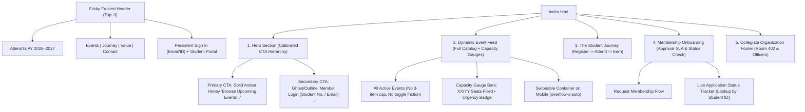

# Implementation Plan: Public Landing Page & Chapter Portal Alignment (v2 — Refined)

## Goal Description
Align the public-facing landing page (`index.html`), associated stylesheets (`css/views.css`, `css/components.css`), and interaction controller (`js/app.js`) with the 5 core project requirements from the syllabus specification and screenshot, incorporating the user's three critical architectural refinements:

1. **The Hero Section (Discovery & Access — Calibrated CTA Hierarchy)**:
   - Compelling headline promoting chapter activities, technical workshops, and accredited participation.
   - **Primary Action**: **"Browse Upcoming Events &darr;"** rendered in **solid Rich Amber Honey fill** (`#D97706` / `--accent-primary`) as the unmistakable visual focal point.
   - **Secondary Action**: **"Member Login (Student No. / Email) &rarr;"** strictly styled as an **outline / ghost button** (`border: 1.5px solid var(--border-dock)`) so first-time visitors naturally flow to the event catalog while returning members have immediate access.
2. **Dynamic Event Feed (The Catalog — Frictionless Full View)**:
   - **Zero artificial limits**: Drop the "Top 3" slice and remove the "Show All" toggle.
   - Provide an immediately browsable, high-impact catalog with standard classifications (*Technical Seminar, Hackathon / Competition, General Assembly, Hands-on Workshop, Community Outreach*).
   - Display title, venue, schedule, and **real-time capacity gauge bars** with scarcity text (`Only 8 seats left!`) and direct "Reserve Seat" booking.
   - On compact viewports, utilize an elegant horizontal swipeable track (`overflow-x-auto` with CSS snap points) so all active semester events are browsable with zero click friction.
3. **The Student Journey (System Benefits — Register &rarr; Attend &rarr; Earn)**:
   - Visual 3-step value sequence communicating the student workflow:
     - **01. Register**: Reserve online before capacity limits fill.
     - **02. Attend**: Instant door check-in via mobile QR pass or Student ID at auditorium kiosks.
     - **03. Earn**: Track certificate eligibility based on completed attendance for collegiate portfolios.
4. **Membership Onboarding (Call to Action & Status Verification)**:
   - Dedicated block specifically for the **Account Registration Approval** workflow.
   - Transparent narrative explaining that non-members submit requests which are cross-referenced with the university student roster by an executive officer within 24 hours.
   - Two interactive actions: **"Submit Account Request"** modal trigger and a live **"Check Application Status"** tool where students query their Student ID to see if their application is *Pending Review* or *Active*.
5. **Organization Footer (Localized Collegiate Grounding)**:
   - 4-column collegiate footer with localized campus data:
     - Office: *Room 402, Technology & Innovation Wing, Student Activity Center Complex, Main Campus*.
     - Primary Venues: *Engineering Amphitheater West & Innovation Lab 4*.
     - Officer Directory: President Danica Navarro & VP Operations Paolo Mercado with official contact details.
     - Administrative governance links and campus social media channels.
6. **Sticky Authentication Architecture**:
   - Ensure the frosted glass header (`.editorial-nav`) is permanently accessible (`position: fixed; top: 0; backdrop-filter: blur(16px); z-index: 1000`).
   - Add a prominent **"Sign In"** button right in the sticky top nav alongside "Student Portal", so a student reading rules down at Section 4 or the footer can open the login modal instantly without scrolling back up.

---

## User Review Required

> [!TIP]
> **Summary of Key Adjustments Made in v2**:
> 1. **Frictionless Event Feed**: Removed the `slice(0, 3)` limitation and "Show All" toggle; all upcoming semester events are rendered immediately in an organized, responsive catalog with horizontal swipe on mobile.
> 2. **Clear CTA Dominance**: The primary Hero button "Browse Upcoming Events" uses solid Rich Amber Honey (`#D97706`), while "Member Login" uses a secondary outline style.
> 3. **Persistent Top Navigation Authentication**: Added a dedicated "Sign In" trigger into the sticky top navbar and mobile drawer, ensuring 1-click modal access from any section of the page.

---

## Open Questions

None. The requirements, architectural refinements, and visual hierarchies are completely aligned.

---

## Proposed Changes



---

### Component 1: Sticky Top Navigation & Header (`index.html`, `css/views.css`)

#### [MODIFY] `index.html`
- In `#main-header` (`.editorial-nav`):
  - Add a dedicated **"Sign In"** button (`btn-pill-ghost`) right before or beside "Student Portal" in `.nav-auth-cluster`:
    ```html
    <button class="header-signin-btn" onclick="App.openLoginModal()" title="Sign in with Student No. or Email">
      <svg width="15" height="15" viewBox="0 0 24 24" fill="none" stroke="currentColor" stroke-width="2.2">
        <path d="M20 21v-2a4 4 0 0 0-4-4H8a4 4 0 0 0-4 4v2"/>
        <circle cx="12" cy="7" r="4"/>
      </svg>
      <span>Sign In</span>
    </button>
    ```
  - In `#editorial-drawer-overlay` (mobile navigation), add a prominent "Sign In with Student No. / Email" item that calls `App.openLoginModal()`.

#### [MODIFY] `css/views.css`
- Ensure `.editorial-nav` has solid sticky/fixed behavior, proper `backdrop-filter: blur(16px)`, `z-index: 1000`, and smooth transition on scroll.
- Add `.header-signin-btn` styles:
  ```css
  .header-signin-btn {
    display: inline-flex;
    align-items: center;
    gap: 0.45rem;
    font-size: 0.85rem;
    font-weight: 600;
    color: var(--text-primary);
    background: transparent;
    border: 1px solid var(--border-dock);
    padding: 0.5rem 0.95rem;
    border-radius: var(--radius-full);
    cursor: pointer;
    transition: all var(--transition-fast);
  }
  .header-signin-btn:hover {
    border-color: var(--emerald-primary);
    color: var(--emerald-primary);
    background: var(--bg-surface);
  }
  ```

---

### Component 2: Hero Section (Discovery & Access with Calibrated CTAs)

#### [MODIFY] `index.html`
- Update `.hero-split-left`:
  - **Headline**:
    ```html
    <h1 class="hero-split-title">
      <span class="title-line">Campus Events.</span>
      <span class="title-line highlight-lead">Verified Attendance.</span>
    </h1>
    ```
  - **Subheader**:
    ```html
    <p class="hero-split-lead">
      Discover technical seminars, campus hackathons, and executive assemblies. Reserve your seat online, scan your instant QR pass at the door, and earn accredited completion certificates for your academic portfolio.
    </p>
    ```
  - **Hero CTA Cluster**:
    ```html
    <div class="hero-cta-nav-cluster">
      <!-- 1. Primary Solid Amber Action -->
      <a href="#events" class="btn-hero-primary-amber">
        <svg width="18" height="18" viewBox="0 0 24 24" fill="none" stroke="currentColor" stroke-width="2.3">
          <rect x="3" y="4" width="18" height="18" rx="2" ry="2"/>
          <line x1="16" y1="2" x2="16" y2="6"/>
          <line x1="8" y1="2" x2="8" y2="6"/>
          <line x1="3" y1="10" x2="21" y2="10"/>
        </svg>
        <span>Browse Upcoming Events &darr;</span>
      </a>

      <!-- 2. Secondary Ghost / Outline Action -->
      <button class="btn-hero-secondary-ghost" onclick="App.openLoginModal()">
        <svg width="17" height="17" viewBox="0 0 24 24" fill="none" stroke="currentColor" stroke-width="2.2">
          <path d="M15 3h4a2 2 0 0 1 2 2v14a2 2 0 0 1-2 2h-4"/>
          <polyline points="10 17 15 12 10 7"/>
          <line x1="15" y1="12" x2="3" y2="12"/>
        </svg>
        <span>Member Login (Student No. / Email) &rarr;</span>
      </button>
    </div>

    <!-- Quick Non-Member Application Prompt -->
    <div class="hero-quick-prompt">
      <span>Not yet an official member?</span>
      <button class="hero-prompt-link" onclick="App.openRequestAccountModal()">
        Submit an Account Request for Officer Approval &rarr;
      </button>
    </div>
    ```

#### [MODIFY] `css/views.css`
- Add distinct styling for `.btn-hero-primary-amber` and `.btn-hero-secondary-ghost`:
  ```css
  /* Primary Solid Amber CTA */
  .btn-hero-primary-amber {
    display: inline-flex;
    align-items: center;
    gap: 0.6rem;
    background: #D97706; /* Rich Amber Honey */
    color: #FFFFFF !important;
    font-weight: 700;
    font-size: 0.98rem;
    padding: 0.9rem 1.65rem;
    border-radius: var(--radius-full);
    text-decoration: none;
    box-shadow: 0 8px 24px -4px rgba(217, 119, 6, 0.45);
    transition: all var(--transition-smooth);
    border: none;
    cursor: pointer;
  }
  .btn-hero-primary-amber:hover {
    background: #B45309;
    transform: translateY(-2px);
    box-shadow: 0 12px 28px -4px rgba(217, 119, 6, 0.55);
  }
  .btn-hero-primary-amber:active {
    transform: translateY(0);
  }

  /* Secondary Ghost/Outline CTA */
  .btn-hero-secondary-ghost {
    display: inline-flex;
    align-items: center;
    gap: 0.55rem;
    background: transparent;
    color: var(--text-primary);
    font-weight: 600;
    font-size: 0.95rem;
    padding: 0.85rem 1.45rem;
    border-radius: var(--radius-full);
    border: 1.5px solid var(--border-dock);
    cursor: pointer;
    transition: all var(--transition-fast);
  }
  .btn-hero-secondary-ghost:hover {
    background: var(--bg-surface);
    border-color: var(--emerald-primary);
    color: var(--emerald-primary);
    transform: translateY(-1px);
    box-shadow: var(--shadow-sm);
  }
  ```

---

### Component 3: Dynamic Event Feed (The Catalog — Frictionless Full View)

#### [MODIFY] `js/app.js`
- **Drop the artificial "Top 3" limit**:
  - Remove `slice(0, 3)` and remove `this.state.showAllEvents`.
  - All upcoming events matching the active filter are rendered directly into `#public-events-container`.
- **Render Dynamic Capacity Scarcity Gauges**:
  - Calculate `fillPercent = Math.min(100, Math.round((ev.registeredCount / ev.capacityLimit) * 100))`.
  - Render fill bar (`fill-green`, `fill-amber`, or `fill-red`).
  - Render urgency text:
    - If `remainingSlots <= 0`: `Waitlist Only` (Crimson).
    - If `fillPercent >= 80` or `remainingSlots <= 10`: `Only ${remainingSlots} seats left!` (Amber with pulse animation).
    - Else: `${remainingSlots} passes remaining` (Emerald).
  - Include event classification badge (Seminars, Hackathons, Assemblies, Workshops, Outreach) and venue location.
  - Action button: "Reserve Seat &rarr;" (or "Join Waitlist &rarr;" if full).

#### [MODIFY] `index.html`
- Update filter chips to support all Master Data event types:
  - *All Events*, *Technical Seminar*, *Hackathon / Competition*, *General Assembly*, *Hands-on Workshop*, *Community Outreach*.
- Container wrapper configured for smooth horizontal swipe on touch/mobile devices (`.public-events-scrollable`).

#### [MODIFY] `css/views.css`
- Add styles for `.public-events-scrollable` (desktop vertical grid, mobile optional swipeable card tray).
- Add styles for `.capacity-gauge-wrap`, `.capacity-track`, `.capacity-fill`, `.capacity-meta-row`, `.capacity-scarcity-badge`.

---

### Component 4: The Student Journey (System Benefits — Register &rarr; Attend &rarr; Earn)

#### [MODIFY] `index.html`
- Insert new section `<section id="student-journey" class="section-wrapper journey-section">` right below `#events`:
  - Section header:
    ```html
    <div class="section-header-title">
      <div>
        <span class="badge badge-emerald" style="margin-bottom: 0.75rem;">System Benefits</span>
        <h2>The Student Journey: How It Works</h2>
        <p>A transparent, 3-step path from seat reservation to accredited academic portfolio credentials.</p>
      </div>
    </div>
    ```
  - 3-card choreographed grid:
    1. **01. Register (Reserve Online)**:
       - Icon: Seat reservation / ticket pass SVG.
       - Copy: Browse semester seminars, workshops, and hackathons. Lock in your confirmed attendee seat before venue limits fill. Passes instantly sync to your student portal.
       - Action: `<a href="#events" class="journey-tag">Browse Events Schedule &rarr;</a>`
    2. **02. Attend (Instant Door Check-In)**:
       - Icon: QR Code scanner matrix SVG.
       - Copy: Present your encrypted digital QR pass to Station Alpha at the door or quote your Student ID. Sub-second contactless check-in logs your attendance timestamp into the master audit trail.
       - Action: `<button class="journey-tag" onclick="App.showInfoModal('checkin')">View Door Protocol &rarr;</button>`
    3. **03. Earn (Certificate Eligibility)**:
       - Icon: Verified Certificate / Stamp SVG.
       - Copy: Attendance records verify completion with executive officers. Mint accredited Certificates of Participation with cryptographic signatures ready for print and portfolio export.
       - Action: `<button class="journey-tag" onclick="App.showInfoModal('certificate')">Accreditation Standards &rarr;</button>`

#### [MODIFY] `css/views.css`
- Add `.journey-grid`, `.journey-card`, `.journey-num`, `.journey-icon-wrap`, `.journey-title`, `.journey-desc`, `.journey-tag`.

---

### Component 5: Membership Onboarding Hub (Account Approval Workflow & Status Tool)

#### [MODIFY] `index.html`
- Replace the simple CTA banner with a dedicated **Membership Onboarding Block**:
  ```html
  <section id="onboarding" class="section-wrapper onboarding-hub-section">
    <div class="onboarding-card-main">
      <div class="onboarding-info">
        <span class="badge badge-amber" style="margin-bottom: 0.75rem;">Admissions &amp; Governance</span>
        <h3>Account Registration Approval Workflow</h3>
        <p>
          Non-members can submit an account request to access the chapter portal. To protect university standards and seat allocations, applications are manually cross-referenced with the collegiate student roster and activated by an executive officer within 24 hours.
        </p>

        <div class="onboarding-steps-list">
          <div class="onboarding-step-item">
            <div class="onboarding-step-badge">1</div>
            <div class="onboarding-step-text">
              <strong>Submit Academic Credentials</strong>
              <span>Provide your official Student ID Number, Full Legal Name, Degree Program &amp; Year, and University Email.</span>
            </div>
          </div>
          <div class="onboarding-step-item">
            <div class="onboarding-step-badge">2</div>
            <div class="onboarding-step-text">
              <strong>Officer Roster Verification (24-Hour SLA)</strong>
              <span>An executive officer verifies your active student standing and approves your digital chapter membership.</span>
            </div>
          </div>
          <div class="onboarding-step-item">
            <div class="onboarding-step-badge">3</div>
            <div class="onboarding-step-text">
              <strong>Instant Chapter Portal &amp; QR Pass Activation</strong>
              <span>Log in with your Student ID or Email to reserve event passes, access door check-in, and download certificates.</span>
            </div>
          </div>
        </div>

        <button class="btn btn-primary" style="padding: 0.9rem 1.8rem; font-size: 1rem;" onclick="App.openRequestAccountModal()">
          Submit Membership Request &rarr;
        </button>
      </div>

      <!-- Right Interactive Box: Status Checker -->
      <div class="onboarding-interactive-box">
        <div>
          <h4 style="font-size: 1.15rem; font-weight: 700; color: var(--text-primary); margin-bottom: 0.35rem;">
            Check Application Status
          </h4>
          <p style="font-size: 0.88rem; color: var(--text-secondary); line-height: 1.5; margin: 0;">
            Already submitted an account request? Enter your Student ID Number or University Email below to check your approval progress in real-time.
          </p>
        </div>

        <form onsubmit="event.preventDefault(); App.checkApplicationStatus();" class="status-query-form">
          <input type="text" id="status-id-input" class="status-query-input" placeholder="e.g. 2025-09120-MN-0" required>
          <button type="submit" class="btn btn-secondary" style="white-space: nowrap;">
            Check Status
          </button>
        </form>

        <div class="status-sample-hints" style="font-size: 0.78rem; color: var(--text-tertiary);">
          <span>Try test applicants:</span>
          <a href="javascript:void(0)" onclick="App.testStatusLookup('2025-09120-MN-0')" style="color: var(--accent-primary); margin-left: 0.3rem;">2025-09120-MN-0 (Pending)</a>
          <span style="margin: 0 0.2rem;">&bull;</span>
          <a href="javascript:void(0)" onclick="App.testStatusLookup('2024-00128-MN-0')" style="color: var(--emerald-primary);">2024-00128-MN-0 (Active)</a>
        </div>
      </div>
    </div>
  </section>
  ```

#### [MODIFY] `js/app.js`
- Implement `checkApplicationStatus(identifier)` and helper `testStatusLookup(id)`:
  - If "Pending Approval": Displays modal detailing the pending status, student credentials, and 24-hour review SLA.
  - If "Active": Displays modal celebrating active status with a 1-click button to sign in directly.
  - If not found: Informs the student and prompts them to submit an application.

---

### Component 6: Organization Footer (Localized Collegiate Grounding)

#### [MODIFY] `index.html`
- Re-architect `main-footer` into 4 localized columns:
  - **Column 1: Organization & Primary Venues**:
    - AttendTa Collegiate Student Chapter.
    - Physical Headquarters: *Room 402, Technology & Innovation Wing, Student Activity Center Complex, Main University Campus*.
    - Primary Venues: *Engineering Amphitheater West (180 seats) & Robotics Lab 4*.
  - **Column 2: Officer Directory & Contacts**:
    - President: *Danica Ysabel Navarro* (`danica.navarro@student.edu`)
    - VP Operations: *Christian Paolo Mercado* (`cpaolo.mercado@student.edu`)
    - Chapter Secretariat: `officers@attendta.chapter.edu` | (02) 8812-4091
    - Office Hours: Mon–Fri, 9:00 AM – 5:00 PM
  - **Column 3: Governance & Administration**:
    - Chapter Constitution & By-Laws
    - Student Data & Attendance Privacy Policy
    - Event Creation & Posting Guidelines
    - Officer & Admin Portal Sign-In (`login.html`)
  - **Column 4: Social Media & Campus Channels**:
    - Official channels with clean SVG icons: GitHub, Discord Community, LinkedIn Collegiate Chapter, Facebook Announcements, Telegram Broadcast.
  - **Bottom Bar**:
    - Copyright 2026 AttendTa Chapter • Accredited Student Affairs Organization.
    - Live System Telemetry: `<span class="footer-status-pill"><span class="badge-dot-live"></span> Door Kiosk Station Alpha: Online</span>`.

---

## Verification Plan

### Automated / Syntax Verification
- Syntax validation on `index.html` and `js/app.js`:
  ```powershell
  python -c "import html.parser; html.parser.HTMLParser().feed(open('index.html', encoding='utf-8').read()); print('index.html syntax OK!')"
  ```
- HTTP dev server response check:
  ```powershell
  curl -I http://localhost:8000/index.html
  ```

### Manual & Interactive Verification
1. **Sticky Header & Authentication Trigger**:
   - Scroll down through each section of `index.html`.
   - Verify the top navbar stays sticky at the top with frosted glass blur.
   - Click the "Sign In" button in the sticky nav from Section 4 and the footer — verify the Login Modal opens immediately with email/student number fields and 1-click demo profiles.
2. **Hero CTA Hierarchy**:
   - Inspect Hero visually: verify "Browse Upcoming Events ↓" has solid Rich Amber Honey fill and commands primary attention.
   - Verify "Member Login (Student No. / Email) →" is styled as an elegant secondary ghost/outline button.
3. **Dynamic Event Feed (All Events & Capacity Gauges)**:
   - Verify all events render without any artificial "Top 3" cutoffs or "Show All" toggle buttons.
   - Verify category filter chips work across all standard classifications.
   - Verify dynamic capacity gauge bars show accurate percentages, fill bars (green, amber, red), and scarcity badges.
4. **The Student Journey**:
   - Inspect the 3 steps (01. Register, 02. Attend, 03. Earn).
   - Test interactive triggers ("Door Protocol" and "Accreditation Standards" modals).
5. **Membership Onboarding & Status Checker**:
   - Click "Submit Membership Request" — test form submission and toast feedback.
   - Enter pending student ID `2025-09120-MN-0` into the status query form — verify the "Application Under Officer Review" modal appears with 24h SLA.
   - Enter active student ID `2024-00128-MN-0` — verify the "Account Approved & Active" modal appears with direct sign-in button.
6. **Collegiate Organization Footer**:
   - Verify Room 402, primary venues, officer names, contact details, governance links, and social media buttons render properly in both desktop 4-column and mobile layouts.
7. **Dark / Light Mode Parity**:
   - Toggle theme using the sun/moon button — verify all 5 sections maintain high contrast and pristine readability.
